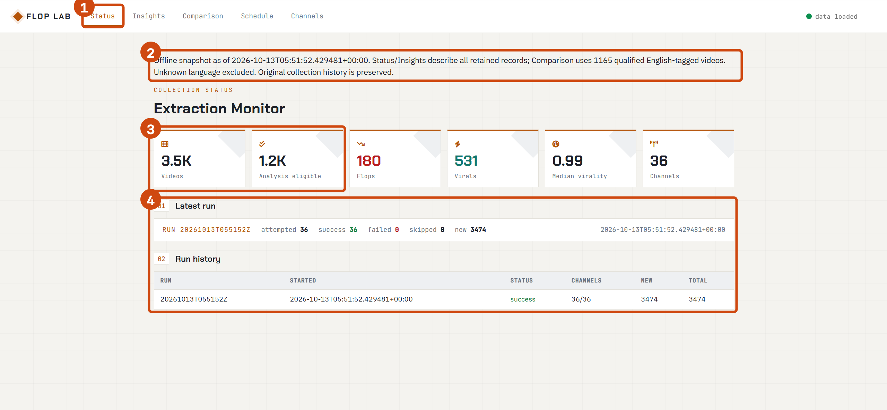
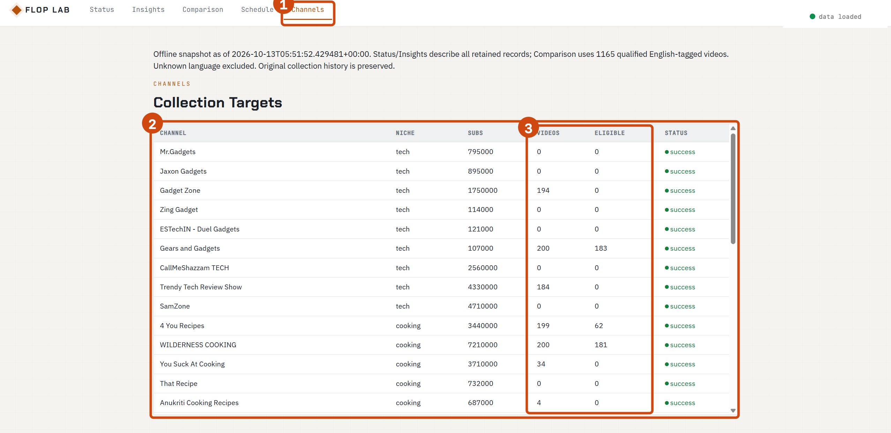
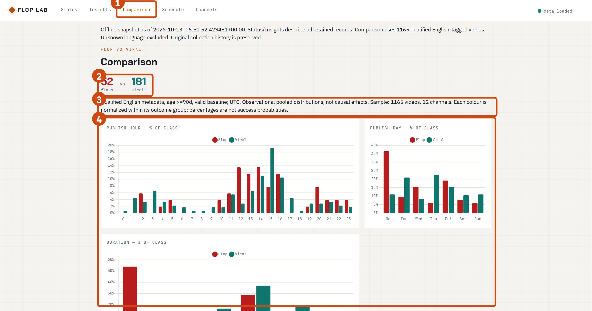
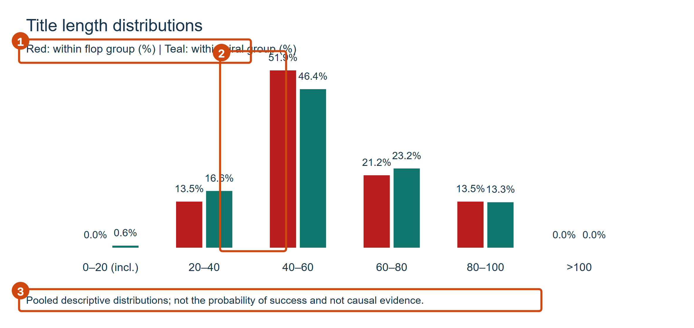
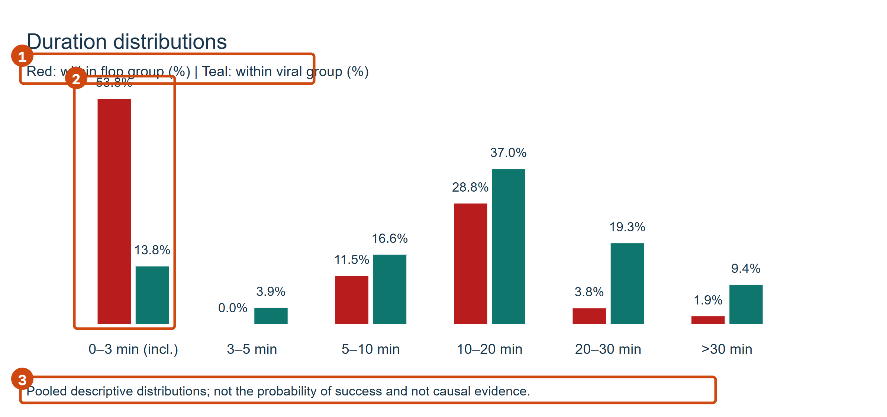

# Anatomy of a Flop

One YouTube channel uploads hundreds of videos. A few of them soar far above the channel's usual
level, and a few sink far below it. This project measures that gap with a **within-channel
relative performance score** and explores whether observable features — title, duration, publish
time — are associated with under- and over-performance. It ships a data collection pipeline, a
fixed offline snapshot, and a local read-only dashboard.

> "Flop" here means *low views relative to the same channel's own history*, not funny fail videos.
> This is an exploratory correlation study; it does not claim causation or predict performance
> before publication.

## How it works

1. **Collect** — `collector/main.py` fetches channel and video metadata through the YouTube Data
   API (pre-registered stratified random channel selection, incremental upserts keyed by
   `video_id`). *Not required for the offline demo.*
2. **Derive** — `collector/derive.py` computes each video's relative performance score against a
   strictly-earlier, 90-day rolling baseline of the same channel, plus title/duration/publish-time
   features.
3. **Qualify** — `collector/quality.py` applies the shared eligibility rules: English-tagged,
   published at least 90 days before the fixed snapshot time, positive baseline, finite score.
4. **Rebuild** — `collector/rebuild.py` regenerates the fixed offline demonstration into
   `results/demo/` **without modifying the original `data/` snapshot**.
5. **Present** — `serve.py` serves a local dashboard (Status / Insights / Comparison / Channels /
   Schedule). In offline mode all collection and scheduling endpoints are disabled.

## Requirements

- Python **3.12+** (developed on 3.12; the pinned combination in `requirements-tested.txt` was
  originally recorded on Python 3.14.6 and revalidated on macOS with Python 3.13.3)
- Windows batch shortcuts are provided; equivalent Windows and macOS/Linux commands are shown
  below

## Setup

```bash
# from the project root (the folder containing serve.py, collector/ and data/)
python -m venv .venv

# Windows PowerShell:
.\.venv\Scripts\python.exe -m pip install -r requirements.txt
# macOS / Linux:
.venv/bin/python -m pip install -r requirements.txt
```

`requirements.txt` is unpinned; `requirements-tested.txt` records the exact versions verified
during handoff. If tests fail on a newer dependency, align with:

```bash
# Windows PowerShell:
.\.venv\Scripts\python.exe -m pip install -r requirements-tested.txt
# macOS / Linux:
.venv/bin/python -m pip install -r requirements-tested.txt
```

## Quick start (offline demo, no API key needed)

```bash
# Windows PowerShell:
.\.venv\Scripts\python.exe -m collector.rebuild        # regenerate results/demo from the fixed snapshot
.\.venv\Scripts\python.exe serve.py --data-dir results/demo

# macOS / Linux:
.venv/bin/python -m collector.rebuild
.venv/bin/python serve.py --data-dir results/demo
```

Then open **http://127.0.0.1:8000/dashboard.html**. Keep the server window open; stop it with
`Ctrl+C`. A standalone chart page lives at `http://127.0.0.1:8000/data/examples.html` (pure local
SVG, works without internet access).

Sanity check after startup: the banner reads **Offline snapshot**, the compact *Analysis eligible*
card reads **1.2K** (the underlying exact count is **1,165**), and *Comparison* shows
**52 flops / 181 virals**. If these numbers differ, do not adjust anything — contact the code
maintainer first.

## Scripts

| Command | What it does |
| --- | --- |
| `prepare_demo.bat` | Rebuild `results/demo` from the fixed snapshot (runs `collector.rebuild`) |
| `start_dashboard.bat` | Start the read-only offline dashboard (rebuilds first if needed) |
| `check_project.bat` | Run the full test suite (54 tests) |
| `python -m collector.rebuild` | Offline rebuild, no API key required |
| `python serve.py --data-dir results/demo [--port 8001]` | Read-only offline mode |
| `python serve.py` | Original online mode (collection + scheduling APIs enabled) |
| `python -m pytest tests` | Run tests directly |

## Environment variables (`.env`, optional)

Copy `.env.example` to `.env` and set `YOUTUBE_API_KEY` **only** if you intend to run live
collection (`python -m collector.main` / `run_collector.bat`). The offline demo ignores `.env`
entirely. Live collection was not re-validated in this iteration — quota fields are rough internal
estimates, not accurate consumption figures. Never share the populated `.env` file.

## Data & outputs

Original snapshot (`data/`, collected 2026-10-13, do not edit by hand):

- `data/videos.csv` — main table, 3,474 rows, one row per video
- `data/channels.csv` — channel niche, subscribers, selection cell
- `data/runs.csv` / `data/channel_status.csv` — collection run history
- `data/raw/` — 7,034 per-video JSON records (processed fields, not full HTTP responses; may
  accumulate multiple collection attempts, so file counts are not single-run counts)

Rebuilt demonstration (`results/demo/`, regenerated by `collector.rebuild`):

- `manifest.json` — input SHA-256 hashes, fixed reference time, sample counts, eligibility policy
- `analysis_videos.csv` — the 1,165 analysis-eligible videos with features
- `channel_audit.csv` — per-channel raw vs. retained coverage
- `insights.json`, `comparison.json`, `progress.json` — dashboard aggregates
- `title_length_buckets.svg`, `duration_buckets.svg`, `examples.html` — local example charts

## Method & fixed snapshot scope

Relative performance score = target video views ÷ median views of same-channel reference videos
published within the 90 days **strictly before** the target, requiring at least 5 references.
Labels: score ≤ 0.2 → *flop*, ≥ 3 → *viral*; videos without a valid baseline are *unknown*, kept
separate from neutral. The snapshot fixes the age reference at **2026-10-13T05:51:52Z** (the
recorded collection start), so numbers do not drift with today's date.

| Number | Meaning |
| --- | --- |
| 3,474 | rows retained in the original main table |
| 1,718 / 1,756 | English-tagged / language-unknown rows |
| 1,165 | analysis-eligible: English-tagged, ≥ 90 days old, positive baseline, finite score |
| 12 | channels covered by the eligible set |
| 52 / 181 | flops / virals among eligible videos |
| 225 | rows with no valid performance score |

Baselines are computed on the surviving main-table history (including language-unknown history);
comparison targets are English-tagged. Status and Insights describe all 3,474 rows. Comparison and
`examples.html` start from the 1,165 eligible-video pool, then plot only its two endpoint groups:
52 flops and 181 virals. Eligible neutral videos are not included in those red/teal distributions.

## Guardrails & limitations

- **Exploratory, not causal.** Distributions are pooled and descriptive; channel, topic and
  video-age confounding remains. A feature being common among virals is not evidence it causes
  virality. No statistical-significance or prediction-accuracy claims.
- **Cumulative views, unequal exposure.** Stored views are snapshots at collection time, not
  per-video 90-day views; older videos have had longer to accumulate.
- **Language tags are not audio verification.** 1,756 rows lack a language mark and are retained
  for review but excluded from the English comparison.
- **Short ≠ Shorts, long ≠ livestream.** Duration alone cannot establish content format.
- **No new collection was run** for this iteration; no extra raw records of unclear origin were
  merged. If reference scope, recovered history, or new data ever changes, all baselines and
  counts must be recomputed and re-handed over — do not reuse the table above.
- Offline mode is read-only: collection/scheduling endpoints return `403`; dotfiles such as
  `.env` and `.git` are blocked; and `/data/` requests cannot traverse outside the selected data
  directory. The dashboard and other non-hidden project files remain locally served from the
  project root. Rebuild verifies the source tables are unchanged (SHA-256) on every run.

## Troubleshooting

- **`python` is not recognized** — install Python 3.12+ from python.org and tick
  *"Add python.exe to PATH"*, or invoke your interpreter directly (e.g. `py -3`).
- **Port 8000 already in use** — add `--port 8001` and open `http://127.0.0.1:8001/...` instead.
- **Dashboard charts are blank** — Chart.js and icon fonts load from CDNs; check the network, or
  use `/data/examples.html`, which is dependency-free.
- **Do not copy someone else's `.venv`.** It records machine-specific paths. Build your own per
  the Setup section.
- **Clicking "re-collect" in online mode is not part of this workflow** — the analysis snapshot is
  fixed; new collection requires team agreement and a fresh handoff.

## 界面展示 / Interface Preview

以下截图来自固定离线快照，方框编号表示建议查看顺序。推荐先核对采集状态和样本范围，再查看
频道覆盖，最后进入两端对比和示例图表。截图用于说明界面与读图方法，不代表因果结论。

These screenshots come from the fixed offline snapshot. Numbered callouts show the recommended
reading order: verify snapshot status and sample scope, inspect channel coverage, then read the
flop-versus-viral comparison and the two example charts. The images explain the interface and
chart-reading workflow; they do not establish causality.

### 推荐使用顺序 / Recommended walkthrough

1. 打开 **Status**，确认页面显示 `Offline snapshot`，并核对视频总量、合格样本和历史运行记录。
2. 打开 **Channels**，查看哪些频道进入主表及分析集；`VIDEOS` 或 `ELIGIBLE` 为 0 不等于频道
   没有视频。
3. 打开 **Comparison**，先核对 52 / 181 两端样本量和 1,165 条合格样本的口径，再读取图表。
4. 打开 `/data/examples.html`，分别查看标题长度和视频时长分布；红色、青色百分比都在各自组内
   归一化，不能解释为成功概率。

1. Open **Status** and confirm `Offline snapshot`, the retained-video count, eligible sample,
   and historical run record.
2. Open **Channels** and inspect main-table and eligible coverage. A zero in `VIDEOS` or
   `ELIGIBLE` does not mean that the channel has no videos.
3. Open **Comparison** and verify the 52 / 181 endpoint samples and the 1,165-video eligibility
   scope before interpreting the charts.
4. Open `/data/examples.html` for title-length and duration distributions. Red and teal are each
   normalized within their own group and must not be read as success probabilities.

### 1. 采集状态总览 / Collection status overview



1. `Status` 页面入口；2. 固定快照范围与排除规则；3. 主表规模和合格样本；4. 2026-10-13 的历史
采集记录。这里显示的是历史运行，不是实时采集。

1. `Status` entry; 2. fixed-snapshot scope and exclusions; 3. retained and eligible counts;
4. the historical 2026-10-13 run. This is a recorded run, not live collection.

### 2. 频道汇总 / Channels overview



1. `Channels` 页面入口；2. 36 个选中频道的汇总表；3. `VIDEOS` 与 `ELIGIBLE` 两列用于区分主表
覆盖和分析资格。数值为 0 不等于频道没有视频，原因见 `channel_audit.csv`。

1. `Channels` entry; 2. summary of the 36 selected channels; 3. `VIDEOS` versus `ELIGIBLE`, which
separates main-table coverage from analysis eligibility. Zero does not mean the channel has no
videos; see `channel_audit.csv` for the reason.

### 3. 两端表现对比 / Flop vs. viral comparison



1. `Comparison` 页面入口；2. 52 条 flop 与 181 条 viral 的两端样本量；3. 合格口径、样本总量和
非因果提示；4. 发布时间、星期和时长的组内构成图。每个颜色按所属类别归一为 100%，不是
“成为爆款的概率”。

1. `Comparison` entry; 2. endpoint samples of 52 flops and 181 virals; 3. eligibility scope,
total sample, and non-causal warning; 4. within-group composition by publish hour, weekday, and
duration. Each color sums to 100% within its own group; it is not the probability of going viral.

### 4. 示例图表 / Example charts

#### 4.1 标题长度 / Title length



1. 红色与青色的组内百分比定义；2. 最大的 `40–60` 字符区间；3. 读图限制：这是描述性分布，
不是成功概率或因果证据。

1. Definition of the red and teal within-group percentages; 2. the largest `40–60` character
bucket; 3. interpretation guardrail: a descriptive distribution, not success probability or
causal evidence.

#### 4.2 视频时长 / Video duration



1. 红色与青色的组内百分比定义；2. 两组差异最明显的 `0–3 min (incl.)` 区间；3. 同样的非概率、
非因果限制。短视频时长也不能单独证明内容属于 YouTube Shorts。

1. Definition of the red and teal within-group percentages; 2. the clearest contrast in the
`0–3 min (incl.)` bucket; 3. the same non-probability, non-causal guardrail. Duration alone also
does not establish that a video is a YouTube Short.


标题长度与时长图从 1,165 条合格视频池中比较 52 条 flop 与 181 条 viral；其余合格中性视频不在
红/青分布内。这是探索性描述，未做频道效应或因果识别。

The title-length and duration charts compare 52 flops with 181 virals drawn from the
1,165-video eligible pool; eligible neutral videos are outside the red/teal distributions.
Exploratory description only; no channel effects or causal identification.
